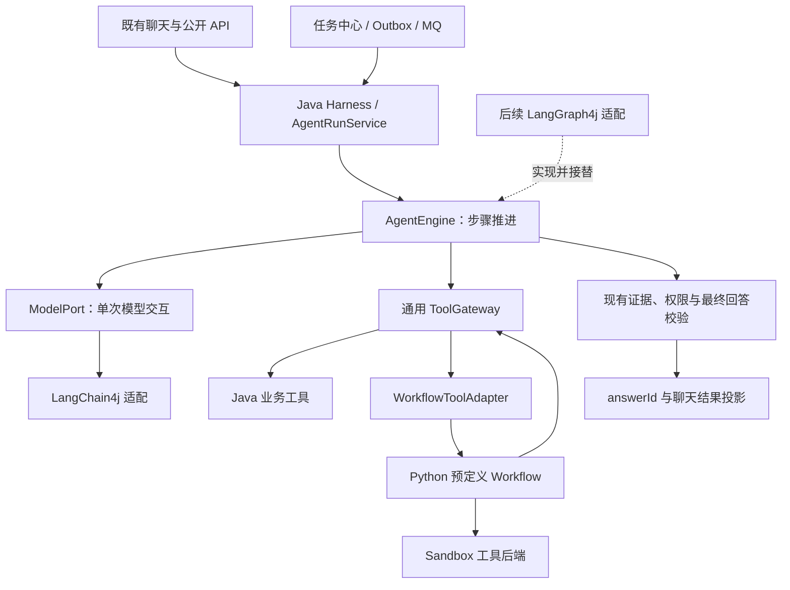

# Workflow 工具化与 Java Harness 方案草案

来源需求：REQ-20261025-002。用户已确认保留预定义 Workflow 为复合工具，以及采用 LangChain4j / LangGraph4j 方向。以下模块细节与分期路线为可审核草案，尚未实现。

## 1. 当前代码与目标差异

本次检查基于 dev 派生工作区 `codex/knowledge-trust-dev`，包含 REQ-20261025-001 的未提交改动，不代表远端 dev 或线上状态。文件路径均相对该工作区。

| 已核实事实 | 依据 | 改造含义 |
|---|---|---|
| Java 17；显式 LangChain4j 依赖是 Qdrant 集成，版本属性为 1.18.1-beta28 | `pom.xml:28-30,61-63`、`src/cloud-server/pom.xml:61` | 已使用 LangChain4j 的部分能力，尚不能认定接入完整模型工具循环；新增依赖需验证兼容性 |
| 公开 API 已存在 | `OpenApiController.java:52,144-189` | 保持 `/api/v1`、`/api/open` 的查询/会话接口，内部换执行引擎 |
| 对话任务类型由 Workflow 全局开关影响 | `KnowledgeChatQueryService.java:150` | 将新建路由与存量恢复路由分离 |
| 模型响应只有 answer、model 和 token 统计 | `service/rag/RagChatResponse.java:6` | 新增独立 Agent 模型回合契约，不能仅在旧 chat 外套循环 |
| Python 模型服务 `/chat` 同样没有原生工具请求/结果契约 | `src/model-service/bge_service.py:209,220,490` | LangChain4j 不能直接把现有 `/chat` 当作支持工具的 provider endpoint |
| 工具调用账本已有参数摘要与幂等控制，但回放要求 executionId 相同 | `workflow/tool/WorkflowToolInvocationService.java:38,81` | 拆开稳定逻辑调用身份与可变执行尝试身份 |
| Python 图执行器按预编译拓扑执行，已有预算、租约、取消与恢复 | `workflow-service/mini_agent_flow/engine/graph_executor.py:185` 等 | 保留为子流程执行能力，Java 承担对话根运行控制 |
| 旧 factory 直接读取历史 assistant 正文；旧 chunk 工具返回 version=1 | `WorkflowRunRequestFactory.java:55`、`WorkflowBuiltinToolConfiguration.java:75` | 新入口不能直接沿用；必须连接当前授权历史与不可变证据 |
| 当前工作区的最终 Workflow 回答会重新授权检索并要求 answerId | `WorkflowAnswerGenerator.java:35` | 保留最终验证；后续抽出可复用验证入口以避免重复生成/检索 |

除 Python 路径外，上表短文件名位于 `src/cloud-server/src/main/java/com/ylcloud/` 的对应包。Workflow 默认是否启用属于配置与部署状态，本方案不据源码宣称线上已启用。

## 2. 目标结构与责任

图中 Python 回调网关仅允许原子工具，不能再次调用复合 Workflow 或启动根 harness。它是有界的父子执行关系，不是循环授权。

| 层次 | 负责 | 约束 |
|---|---|---|
| 平台领域服务 | 身份、Space 权限、版本策略、审批、证据、最终发布 | 身份与授权范围由服务端生成，模型不可自行指定 |
| Java harness | 根 run、上下文组织、预算、取消、等待、恢复、事件 | 一次 run 只有一个步骤引擎和一个有效执行者 |
| AgentEngine | 执行一次模型/工具/终结步骤，推进 checkpoint | 首期有界串行实现；后续可替换为 LangGraph4j 适配 |
| ModelPort | 一次请求对应一次模型返回，含工具调用与 usage | 可由 LangChain4j 实现，不在内部自动执行工具循环 |
| ToolGateway | 工具目录、schema、权限、幂等、副作用、结果读取 | 执行前与结果回放时均重新检查权限 |
| Workflow 复合工具 | 有明确输入输出的版本化预定义流程 | 不写聊天终态、不扩范围、不重置父预算 |
| 任务中心与 MQ | 可靠受理、投递、唤醒、worker fencing | 不重新执行整条 Agent 链来代替恢复步骤 |

首期放在现有 `cloud-server` 中，按包隔离职责；不先增加新的 Java 服务或 Maven 子工程。现有 Python Workflow 和 sandbox 保持进程边界。若将来出现独立扩缩容需求，可在契约稳定后单独拆部署。

## 3. 新增或显著重构模块的审核说明

### 模块 A：Java Harness 运行控制

说明版本 v1；审核状态：待审核。已确认的是 Java/4j 方向及 Workflow 从属关系；下列数据结构与执行细节尚未逐项确认。未决设计项：分期接入路线或首期直接接入 LangGraph4j，见第 7 节；其余具体字段可在契约任务中收敛。

#### 1. 解决的问题

把整个对话的决策循环、恢复位置与运行限制从固定 Workflow 图中分离。入口服务保留业务受理，harness 驱动“模型 → 工具 → 观察 → 下一轮”，并把候选答案交给已有最终校验。它不实现文件权限、向量检索算法或通用图编译器。

#### 2. 不增加会怎样

保持现状仍可执行固定知识问答与预定义图，但无法在统一控制下依据工具结果进行自主后续决策。也可以直接用 LangGraph4j 实现步骤推进；即使如此，平台仍需运行身份、预算、权限和结果发布边界。

#### 3. 核心数据结构及所有权

- 拟新增 `AgentRun`：runId、sessionId/messageId、服务端 principalRef、初始 scopeRef、engineType/engineVersion、schemaVersion、status、deadline、累计预算、cancelRequested、epoch/leaseToken、eventSeq、最终结果引用。
- 拟新增 `AgentStep`：stepId、runId、stepIndex、类型、状态、输入摘要、模型响应/结果引用、下一恢复位置。保存执行所需协议与审计信息，不要求记录模型隐式思维链。
- 拟新增版本化 `RunCheckpoint`：已完成步骤、未完成工具调用、预算预留、上下文引用、待审批/待工具信息。它不能把保存时的权限永久冻结为有效权限。
- 拟新增 `RunEvent`：runId + epoch + eventSeq，供消息与任务状态幂等投影。现有聊天消息是投影，不能作为另一套独立推进状态机。
- 根运行状态可包括 QUEUED、RUNNING、WAITING_TOOL、WAITING_APPROVAL、FINALIZING、SUCCEEDED、FAILED、CANCELLED、NEEDS_RECONCILIATION；事件携带明确失败原因。未来若有澄清交互再扩展，不靠自由文本猜状态。
- harness 的 RunStore/引擎适配器管理唯一有效恢复位置；任务中心继续提供 worker 租约，run 写入必须校验映射的 epoch/lease。避免再启动一个独立抢租约调度器。
- LangGraph4j 接入后接替步骤/checkpoint 实现；根状态、预算和有效 checkpoint 指针仍以同一 RunCommit 版本为准，不能让图状态与根表分别推进。消息表才是对外投影。副作用账本仍由工具域持有，不搬入图内存。提交协议见第 6 节。

#### 4. 调用链

既有 API → 当前身份与任务幂等校验 → 原子创建 run/消息关联及 Outbox → MQ 唤醒 → 取得当前执行租约 → 重建授权上下文 → AgentEngine 执行单步 → ModelPort/ToolGateway → 保存结果和 checkpoint → 下一步或释放 worker 等待 → 最终证据验证 → 服务端 answerId → 幂等投影完成消息。

恢复入口根据 run 中的 engineType 和版本调用对应适配器。等待审批或长工具时不占用线程轮询；采用回调或可靠的延迟查询任务唤醒。过期 worker 即使完成外部请求，也不能推进新 epoch 的状态。

#### 5. 设计依据与代价

候选草案把现有 MQ 可靠投递与 Agent 内部恢复区分开，减少重复重试。串行执行便于首先验证副作用与预算；代价是首期不能发挥并行工具吞吐，需自行维护一个最小步骤实现。每次恢复重新授权会增加读取成本，但避免 checkpoint 泄露已撤权内容。

#### 6. 替代方案

首期直接以 LangGraph4j 实现 AgentEngine，可减少临时循环代码，但要同时解决版本、持久化及中断恢复适配。继续以 Python Workflow 管根运行改动较少，却不满足用户已经确认的边界。独立 Java harness 服务可独立扩缩容，但增加跨服务权限、事务与运维成本，当前没有必须拆服务的证据。

#### 7. 面试讲法

“规划中把 Agent 的根运行控制放到 Java harness，由模型决定下一步，但权限、预算、工具幂等和最终答案验证仍由平台执行。Workflow 只承担子任务。通过引擎接口为 LangGraph4j 留出替换点。”这是设计，尚无本次改造的上线或性能结果。

#### 8. 三个理解问题

1. 为什么已具备固定 Workflow 图执行，还需要单独定义根对话的运行责任？
2. 工具成功后进程退出，重启从哪个身份和哪份持久化结果恢复？
3. 首期直接使用 LangGraph4j 与先实现有界串行引擎，各多承担什么验证成本？

### 模块 B：Agent ModelPort 与 LangChain4j 适配

说明版本 v1；审核状态：待审核。框架方向已确认；适配契约为草案。依赖版本与当前模型能力是实施验证项，无需用户先选未验证版本。

#### 1. 解决的问题

当前 RagChatResponse 不表达原生工具调用、调用关联和结束原因。新增 Agent 专用模型入口，使工具请求、结构化候选答案、usage 有明确协议，同时保留现有 RAG、embedding、rerank 调用。

#### 2. 不增加会怎样

直接复用纯文本 answer，容易把自然语言或文档中的伪指令当作执行命令；JSON 输出本身也不等于模型原生工具调用。不需要工具的现有问答可暂时继续旧入口，但不能声称它实现了新的 Agent 协议。

#### 3. 核心数据结构及所有权

- `ModelTurnRequest`：规范化消息、工具定义快照、输出约束、模型配置引用、剩余预算与超时；不携带可被模型修改的真实认证信息。
- `ModelTurnResult`：模型消息、零到多个 ToolCallProposal、结构化候选回答、usage、finishReason、providerRequestId。
- ToolCallProposal：providerCallId（可能缺省）、toolName、参数 JSON。harness 为持久化后的调用生成稳定平台 invocationId，保存两种 ID 映射。
- 工具 schema 与输入限额来自平台工具目录；业务 API 和业务数据表不依赖 LangChain4j 类的序列化格式。
- 大响应与原始协议可按受控引用保存，日志脱敏；模型上下文只保留可授权的内容或引用。

#### 4. 调用链

AgentEngine → ModelPort → LangChain4j 低层 ChatModel/ToolSpecification 适配 → 支持原生工具协议的 provider endpoint → 规范化返回 → schema/预算/finishReason 检查 → 持久化决策 → ToolGateway 或最终校验。模型不可用、截断或格式错误进入有界失败/纠正分支，不执行未完成工具参数。

当前 Python 模型服务 `/chat` 只接受 RAG 文本生成协议，不能直接作为上述 endpoint。草案中的 LangChain4j 适配路线是由 Java 接入经验证的 provider 原生接口，配置和凭据继续由服务端管理，API 不接受任意客户端指定 URL 或密钥。若部署要求所有模型流量必须经过 Python 模型服务，则另一路线是为它增加完整 Agent 回合透传协议，并提供对应 ModelPort HTTP 适配；保留 messages、工具定义、调用 ID、工具结果、usage 和 finishReason，不能降级为拼接 prompt。阶段 0 核实实际网络/配置边界后固定一条接入路线，不将现有 `/chat` 的兼容性视为已验证。

#### 5. 设计依据与代价

单次交互接口让外层步骤引擎看见每次工具提议和费用。LangChain4j 官方区分低层手动工具执行与高层 AI Services 自动工具执行；本草案使用前者保持一个循环所有者。这是项目的设计取舍，不是框架不具备 Agent 能力。[官方工具文档](https://docs.langchain4j.dev/tutorials/tools/)

代价是需要消息转换和 provider 能力验证。首期可把同一轮多个工具按稳定顺序串行执行，不承诺并行；全部调用与返回必须保持对应关系。

#### 6. 替代方案

直接扩展现有 HTTP 模型客户端可少引入依赖，但需自己维护各 provider 工具协议。AI Services 自动工具循环适合由它独自负责执行的应用；若再外套 LangGraph4j 循环，需要额外证明预算、checkpoint 和副作用边界，不能两边同时自动执行。当前草案不采用双循环。

#### 7. 面试讲法

“规划把 LangChain4j 放在模型适配层，每次只做一次模型交互。平台拿到工具请求后再做授权和执行，因此更换模型 SDK 或外层图引擎不改变业务工具契约。”目前仓库已有 Qdrant 集成，不能把它表述为此模块已实现。

#### 8. 三个理解问题

1. 强制模型返回 JSON 为什么仍不足以替代可靠工具调用协议？
2. providerCallId 缺省或变化时，平台如何保证一次逻辑工具调用的身份稳定？
3. 何时让 AI Services 自动执行工具合理，何时会与外层引擎产生职责冲突？

### 模块 C：通用工具网关与 Workflow 复合工具适配

说明版本 v1；审核状态：待审核。保留预定义 Workflow 作为复合工具已获用户确认；本节是在现有工具域上重构和新增适配，不是重做所有业务工具。

#### 1. 解决的问题

让 Java harness、Python 子流程以及未来引擎通过同一业务工具边界调用能力。复用注册、风险校验、权限和 sandbox，解除 run/node/execution 命名对 Workflow 的专属耦合，并防止跨恢复重复副作用。

#### 2. 不调整会怎样

仅把旧 Workflow HTTP 调用包装成一个方法，也能启动流程，但根/子预算、取消、权限与幂等仍可能错位。每个框架各写一套工具会复制权限逻辑；直接向模型提供任意 Graph JSON 则不满足“预定义工作流”的范围。

#### 3. 核心数据结构及所有权

- 复用并扩展 `ToolDefinition`：name/version、input/output schema、risk、sideEffect、timeout、同步或异步、幂等策略、允许调用者类型。
- 服务端 `ToolExecutionContext`：principal、API Key、session、rootRunId、stepId、invocationId、attemptVersion、rootEpoch/leaseToken、必要的 childRun/childEpoch、scopeRef、deadline、预算预留。模型只填写业务参数。
- `ToolInvocation`：稳定 invocationId、run/step、规范化参数摘要、授权/审批摘要、工具版本、状态、结果引用；执行 attempt 单独保存。参数或调用主体变化必须创建新的合法逻辑调用，不能覆盖旧账本。
- `ToolResult`：结构化业务结果、证据/产物引用、usage、完成或等待状态、错误类型和是否可安全重试。成功回放也先校验当前访问资格。
- `WorkflowToolBinding`：服务端注册的 toolName → templateId + immutable templateVersion + 输入/输出映射 + 权限需求 + 子预算上限。
- `ChildRunBinding`：父 invocationId → 子 workflowRunId，创建子流程时采用相同稳定幂等键；网络超时后查询绑定，不能直接新建第二个子流程。
- 审批记录绑定用户、工具、参数摘要、范围与有效期；审批消息不能由模型自称授权。

#### 4. 调用链

harness 持久化调用意图和预算预留 → ToolGateway 校验 schema、当前范围及审批 → 以短事务校验根/子当前 epoch、取消状态、deadline 与预算并原子 claim 稳定 invocation → 事务外调用业务 handler 或 WorkflowToolAdapter → 子服务按 invocationId 幂等创建/读取 → 等待时持久化句柄并释放 worker → 保存业务结果 → 推进父 checkpoint。

旧 worker 不能只凭内部签名继续提交新副作用。执行 claim 与当前根/子状态检查必须在同一受约束写入中完成；Java 业务写入尽可能在事务内再次验证 fence，外部服务使用稳定幂等键/条件版本。外部系统不支持 fencing 时，已经发出的动作无法靠本地租约撤销：恢复须查业务效果，无法确认则进入结果未知状态，不宣称严格 exactly-once。根 epoch 变化后，子流程恢复需重新建立当前授权绑定，不改变原 invocationId 或新建另一个子 run。

Python Workflow 回调原子工具仍走签名内部网关；网关验证父子绑定、模板允许工具与实际 principal，不信任模型提供的身份。父取消、到期、授权失效阻止新增子动作，并传播取消至可取消的子执行/sandbox。取消不能撤销已经成功的外部副作用，需明确呈现已完成动作。

#### 5. 设计依据与代价

工具账本记录实际业务效果，checkpoint 记录执行位置。二者不能用一次跨 HTTP 的本地事务冒充原子性；需要“持久化意图 → 幂等执行/查询 → 持久化结果 → 推进”的恢复路径。结果未知进入 NEEDS_RECONCILIATION，只有确认可安全重试的操作才重试。

父 run 为子 Workflow 预留配额，子流程在配额内执行并汇报累计用量；父结算按单调序号去重。预留先持久化再允许启动子流程，只有收到可信终结/对账结果后才返还未用额度；失联时不能假定没消耗而退回额度。父预算包括子流程内部模型调用、工具调用与重试；用统一 usageEventId 区分复合工具调用开销与子内部真实调用。事件身份由 rootRunId、实际逻辑调用 ID、attempt 和 usageKind 组成：Java 网关观察到的子调用与 Python 报告必须携带同一身份合并去重，Python 独有模型调用另计；幂等结果回放不是新模型/工具执行。子配额结算将预留转换为实际消费，不能保留预留再叠加整笔消费。token 类额度按已知输入与最大输出保守预留，按 provider usage 对账；无法测准的成本明确记录估算，不伪造精确费用。子 deadline 不晚于父 deadline。

#### 6. 替代方案

原子工具重写所有旧流程可减少 Python 服务，但丢失现有预定义工作流资产，不符合已确认选择。把旧 Workflow 当无约束黑盒接入成本低，却无法满足父预算与恢复要求。未来可把部分模板实现迁移为 Java 子图，保持工具契约；这不是首期必要工作。

#### 7. 面试讲法

“规划保留现有工作流的固定执行能力，把它封装成版本化复合工具。父 Agent 决定何时调用，平台统一控制权限、幂等、预算与取消。恢复回放同一次调用，不靠换 ID 重做。”当前已有工具网关与沙箱，本次父子协议和通用化尚未实现。

#### 8. 三个理解问题

1. 为什么工作流有自己的局部状态机，并不意味着它仍然主导整个对话？
2. 创建子流程的 HTTP 请求超时后，父 run 应先查询什么来避免重复执行？
3. 为什么既要工具效果账本又要 checkpoint，外部结果未知时为何不能直接重试？

上述理解问题用于讲解，不是用户批准或实施的额外前置条件。

## 4. 不可弱化的运行与可信边界

1. **单一执行权**：一个 run 绑定 engineType/engineVersion；旧 epoch 不能写入新状态。LangGraph4j 接入后不与自建引擎共同推进同一个 run。
2. **授权不是快照**：执行范围 = 受理时允许范围与当前权限的交集。每次恢复、读取工具结果及最终发布重新检查；模型不可扩大 Space 范围。框架内存和摘要不能替代 ConversationContextService 的授权历史。
3. **checkpoint 不保存永久可用证据**：优先存证据引用。恢复后若引用失效，移除对应文本及依赖它的摘要/草稿；无法安全重建时终止或重新执行只读检索，不能继续消费旧明文。
4. **结果类型分开**：知识结论经现有结构化验证、证据支持判断和政策规则后取得 answerId；操作成功只由持久化工具回执证明，不能作为知识依据。首期不借此扩张为无知识范围的自由回答产品。
5. **发布受控**：中间模型文本、工具原文与未验证结论不直接流入用户最终回答。可以输出脱敏的状态进度；已有读取接口仍逐次检查权限。
6. **重试有界**：模型调用、工具调用、Judge、重试和子流程都计入根运行额度；副作用未知不重试。保留最终验证所需预算，不能耗尽预算后跳过校验。
7. **工具内容按不可信数据处理**：文档和子 Workflow 输出不能变成系统指令、权限批准或新工具定义。输出大小、类型、证据归属、错误码均校验。
8. **同会话并发显式排序**：第一阶段沿用提交序列，定义每条 run 的历史截止点。重复投递不能启动两个执行者；等待中的 run 是否阻止后续消息以现有会话语义为基准，在 API 回归中确认，不使用框架共享 ChatMemory 隐式排序。

## 5. 需要修改的模块

下表是预计修改范围，不代表文件已经修改。首期优先新增通用接口和兼容适配，再收敛旧命名，避免一次性大规模搬包。

| 模块/路径 | 变更 |
|---|---|
| `cloud-server/.../service/KnowledgeChatQueryService` | 受理后绑定运行引擎；新对话转入 harness，保留用户、API Key、幂等及消息契约 |
| `cloud-server/.../workflow/client/WorkflowMessageLifecycleService` | 根生命周期从新对话路径退出；保留旧 run 查询、取消、恢复兼容 |
| `cloud-server/.../workflow/client/WorkflowRunRequestFactory` | 停止作为新对话请求工厂；新增 AgentRunInput，通过受权上下文服务构造 |
| 拟新增 `cloud-server/.../agent/harness` | AgentRunService、AgentEngine、RunStore/checkpoint、预算、取消、恢复与事件投影 |
| 拟新增 `cloud-server/.../agent/model` | ModelPort、框架无关消息/工具协议、LangChain4j 适配及能力检查 |
| `src/model-service/bge_service.py` 及模型配置边界 | 保留原 RAG `/chat`；阶段 0 核实 Java 直连 provider 方案。若必须走 Python 代理，则增加独立 Agent 回合协议及 HTTP 适配，不能声称现接口已支持工具 |
| `cloud-server/.../workflow/tool` 与拟新增 `agent/tool` 门面 | 复用注册与业务 handler；拆分逻辑调用/attempt，改进短事务及结果查询；新旧协议适配 |
| `InternalWorkflowToolController` | 保留旧签名入口兼容；新增协议明确根/子身份与范围，不把认证字段交给模型 |
| 拟新增 `WorkflowToolAdapter` 与现有 `WorkflowHttpClient` | 模板白名单、固定版本、父子绑定、幂等创建、异步结果、取消和预算契约 |
| `WorkflowBuiltinToolConfiguration` | 检索/读取改接受权修订与证据服务；限制 API Key 和父 run scope；清除写死版本语义 |
| `ConversationContextService` | 向 harness 提供当前授权历史；审查恢复/摘要路径，证据服务不可用时拒绝退回不受权历史 |
| `WorkflowAnswerGenerator`、可信问答与 `RagEvidenceService` | 复用并整理最终验证入口；保留 answerId、当前权限、版本与推断策略，不直接信任冻结子流程输出 |
| `async/worker`、统一任务中心/Outbox | 新的 run 唤醒/恢复 handler；沿用现有 lease fencing，避免重复调度层 |
| `workflow-service/mini_agent_flow` contracts/engine/persistence | 增加子运行协议；保留模板、编译执行器、局部 budget/lease/cancel；对话根入口逐步停用 |
| `sandbox-service` | 保留执行隔离，补充验证父子取消及截止时间传递，通常不需重写运行时 |
| `cloud-pojo`、数据库 migration | 增量添加 run/step/child binding 等必要结构及引擎关联；保留旧 workflow 字段和账本直至迁移完成 |
| `OpenApiController`、`OpenApiKnowledgeChatService`、`docs/openapi-v1.yaml` | 业务查询路径兼容；必要时增加可选运行状态字段，禁止输出框架内部 checkpoint 或明文认证上下文 |
| 前端 `AssistantPage` / API types | 按统一状态显示等待、审批、失败、取消与验证后的最终答案；不要求用户理解引擎类型 |
| `pom.xml`、cloud-server 配置与部署配置 | 4j 版本矩阵、模型能力、根引擎开关和 Workflow 复合工具开关分离；默认值与灰度步骤显式记录 |

数据库迁移编号在实现时按当时最大编号申请，避免与当前未提交的可信问答迁移冲突。此次不改表、不回填运行记录。

## 6. 持久化、迁移与回滚

### 持久化职责

| 数据 | 权威写入方 | 其他模块可做什么 |
|---|---|---|
| run 根状态、预算与执行引擎绑定 | Java harness 当前有效执行者 | 消息/任务中心只投影或请求取消 |
| 步骤位置与 checkpoint | 绑定的 AgentEngine 及其存储适配器 | 不允许另一个引擎自行推进 |
| 工具业务效果/幂等结果 | Java 工具域与实际执行服务 | 引擎可以查询结果，不能伪造成功或清空账本 |
| 子 Workflow 局部节点状态 | Python Workflow 服务 | 父 run 通过子绑定查询/取消，不直接写子表 |
| 证据、可信答案与权限 | Java 领域服务 | 引擎仅保存引用并调用受权读取 |

### 根状态与 checkpoint 的提交协议

每次推进以 `RunCommit(runId, expectedVersion, epoch, checkpointRef, status, budgetChanges, eventSeq)` 为唯一生效点：在同一数据库事务中 CAS 当前 run 版本和 fence，更新根状态、预算预留/结算、有效 checkpoint 指针与 Outbox 事件。工具业务效果账本先独立持久化，推进失败时可回放同一结果。

若 checkpoint 存储无法加入该事务，先写不可变的 staged checkpoint，再由上述事务引用其精确 ID；只有已提交指针指向的 checkpoint 可以恢复。写入后未引用的孤立 checkpoint 不得被 saver 的“latest”查询自动选中，可在确定无引用后清理。恢复加载根提交版本与其 checkpoint，不能各取两个存储的最新值。

首期 RunStore 与后续 LangGraph4j Checkpointer 适配均需遵守这一协议。不能只配置一个默认 saver，再让根表/预算另外写入；若选定框架 saver 无法支持精确恢复与该提交边界，必须补适配后再切流量。迁移按 run 固定引擎，不要求不同引擎解释彼此的 checkpoint 内容。

### 迁移顺序

1. 增量部署契约、必要表和兼容读取逻辑；新 harness 默认不开流量。为旧任务识别 engineType 的回填规则做只读清点。
2. 修复新旧入口共享的授权与幂等边界，再以测试范围开启 Java harness；工具初期仅提供已完成验证的白名单。
3. 旧根 Workflow 停止接收新对话；已有 run 按创建时引擎继续排空，必要时显式取消。保留查询和幂等账本。
4. 逐步切换新任务路由；复合 Workflow 的运行开关独立，不随着旧根 Workflow 入口停用而失效。
5. 存量排空、回归通过后删除失效的顶层路由代码；不连带删除模板执行器或历史记录。

### 回滚边界

路由回滚只影响新任务，已创建 harness run 仍由原版本处理或明确取消。禁止将半途 run 改派旧 Workflow 重做。数据库只做向后兼容增量变更；只要新引擎还有活动 run，就保留对应 worker 和读取能力。回滚代码不能撤销已经成功的外部动作。

## 7. 合理路线与分期交付草案

已确认选择排除了 Python 作为根对话编排、删除全部 Workflow 两种方向。以下两条 Java 路线仍满足目标：

| 评价顺序 | A：先有界引擎，后接 LangGraph4j | B：首期即由 LangGraph4j 实现 AgentEngine |
|---|---|---|
| 1 需求与业务价值 | 首期实现根控制和工具化，框架分期 | 根控制和图框架同批交付 |
| 2 安全 | 都需平台授权、证据和工具门禁 | 同左，框架不自动解决 |
| 3 可靠性 | 先验证最小状态机，后验证替换 | 首期一起验证 saver、中断及恢复 |
| 4 可维护性 | 有一段后续可删除的简单引擎实现 | 减少临时引擎，但更早依赖框架 |
| 5 交付复杂度 | 首批变更面小，分两轮运行验证 | 首批依赖与状态适配更集中 |
| 6 性能扩展 | 首期串行，图与并行能力后置 | 可更早利用图表达，但仍先约束并发 |
| 7 成本 | 两次引擎验证和迁移成本 | 初期兼容性与持久化验证成本 |
| 8 团队适配 | 先理解业务边界，再学习框架执行 | 同期学习 LangGraph4j 执行语义 |
| 9 锁定风险 | 通过端口隔离；后续不能双引擎推进 | 同样通过端口隔离，避免框架状态侵入 API |

下列路线按用户“为后续铺垫”的措辞给出 A 的评审草案；不是已确认的不可变技术决定。选择 B 时合并阶段 2 与 5，其余工具与可信边界保持一致。

| 阶段 | 可独立评审的交付物 | 验收重点 | 回滚 |
|---|---|---|---|
| 0 契约与兼容性 | AgentRun/ModelTurn/ToolResult 契约；原生工具能力与 Java17/4j/Qdrant 版本矩阵；旧任务清点 | 无框架对象进入业务协议；明确不支持工具的模型行为 | 只增加契约，现路由不变 |
| 1 工具边界 | 通用门面、逻辑 invocationId/attempt、当前授权、受权知识工具、结果查询 | 重复投递、权限收回、外部结果未知、旧协议回放 | 继续旧入口；保留新账本数据 |
| 2 Java harness | ModelPort 适配、有界串行引擎、checkpoint、预算与取消、可信终结 | 模型→工具→观察闭环；故障恢复不重做成功副作用 | 新 run 灰度关闭，已有 run 排空 |
| 3 复合 Workflow | 模板注册、父子绑定、预算预留、等待/唤醒与取消传递 | 创建超时后查同一子 run；子内部调用计费不逃逸 | 禁用新复合调用，已有子 run 查询/取消仍可用 |
| 4 API 迁移 | 既有 API 转接、状态投影、旧任务排空、必要前端状态与运维指标 | 新旧混跑、重复回调、旧 epoch、撤权与可信答案回归 | 新任务路由回滚，旧/新 run 各按绑定执行 |
| 5 LangGraph4j 接入 | AgentEngine/Checkpointer 适配和持久化验证；不迁移活动 run | 同一工具/权限/最终验证契约通过；跨实例恢复与取消成立 | 新 run 切回原引擎，Graph run 保留原 worker |

### 4j 接入核验

- LangChain4j 提供低层工具请求与手动执行接口，适用于本设计的单回合 ModelPort。不能把 JSON mode 等同于工具协议，也不能依赖模型自行遵守 schema 作为唯一校验。[官方说明](https://docs.langchain4j.dev/tutorials/tools/)
- LangGraph4j 提供 StateGraph、条件边、checkpoint、恢复/中断等机制，可实现 AgentEngine；本项目仍需验证它与自身执行租约、预算和工具账本的协作。[官方核心文档](https://langgraph4j.github.io/langgraph4j/1.9/core/core-library/)
- LangGraph4j 是独立 Java 项目，不能直接套用 Python LangGraph API 或持久化保证。业务 sessionId 与图执行 threadId 分开：草案以每个 run 唯一标识映射图线程，业务历史由 Java 授权上下文提供。
- 当前仓库的 Qdrant beta 版本不证明未来 LangChain4j core/provider 和 LangGraph4j 组合兼容。实施时锁定统一依赖清单，验证 Java17、Jackson/HTTP 依赖、工具 schema、错误映射及 Qdrant 现有调用；不在本规划中直接升级。

## 8. 测试交接与完成标准

这是测试范围与通过门槛，不是已执行测试报告。前一轮可信问答测试结果不能用于证明本次 harness 已完成。实施者需按具体功能补齐完整用例、测试数据、步骤、预期/实际结果与独立测试文档。

| 范围 | 必须验证的场景与判定 |
|---|---|
| 模型协议 | 无/单/多工具调用、缺失调用 ID、格式错误、截断、不支持工具、模型超时；不得执行部分参数或自由文本命令 |
| 状态与副作用 | 重复 MQ、双 worker、租约过期、结果已写但 checkpoint 未写、未知副作用；实际业务效果不重复，旧 epoch 写入失败 |
| 提交边界 | staged checkpoint 写成但 RunCommit 失败、预算已预留后宕机、旧 worker 尝试 claim 新工具；只恢复已提交指针，不选孤立最新 checkpoint，失租调用被拒绝 |
| 授权与可信问答 | API Key scope 收紧、撤权、文件删除/换版、历史引用失效、恶意工具文本、伪证据、政策与知识推断；不得泄露无权内容或绕过最终校验 |
| Workflow 父子链路 | 子创建响应丢失、重复回调、子超时、父取消、沙箱取消、模板版本变化；绑定稳定，工具不会自建第二个根 run |
| 预算 | 多次恢复、模型重试、Judge、子流程多次调用、失联结算；预算不归零、不重复返还、不超出服务端限额继续新动作 |
| 公共 API/前端回归 | 原有查询与任务读取、幂等键、错误码、等待/取消展示、answerId、证据页面；不暴露原始 checkpoint 或未审答案 |
| 兼容性 | Java17、所选 4j 矩阵、旧数据库数据、旧 Workflow 协议和任务排空；增量部署和新流量回滚成立 |
| 集成与端到端 | 真实 DB/MQ/Workflow/sandbox、具备工具能力的模型；至少一条原子工具链和一条复合工具链执行后再验证重启恢复 |
| 容量与观测 | 并发会话、工具等待释放线程、队列积压与超时；输出明确的耗时/资源基线，不在未测时宣称性能提升 |

观测字段至少包含 run/step/invocation/childRun 关联、引擎与模板版本、执行耗时、模型/工具累计次数、预算终止、恢复次数、幂等回放、未知副作用、引用/政策拒答原因。敏感正文和凭据不写普通日志。

## 9. 审核状态

- 已确认：Workflow 为预定义复合工具；Java 生态，LangChain4j / LangGraph4j 方向；沿用既有可信问答配置和权限边界。
- 待审核：模块 A、B、C 的 v1 设计；分期路线 A，或将 LangGraph4j 提前到首期的路线 B。
- 工程待验证：具体版本矩阵、实际模型能力、运行环境旧任务存量、故障恢复与并发结果。没有将这些未知事项描述为已通过或风险已被用户接受。
- 本文形成可审核草案，未生成实施完成记录。审核后再拆分原子 TASK 与 TEST 文档，并据实更新状态；新增模块或改变已确认边界时只评审变化部分。

2026-10-25：基于当前工作区源码与官方 4j 文档完成草案。无本次 harness 实现、测试、提交或部署。
